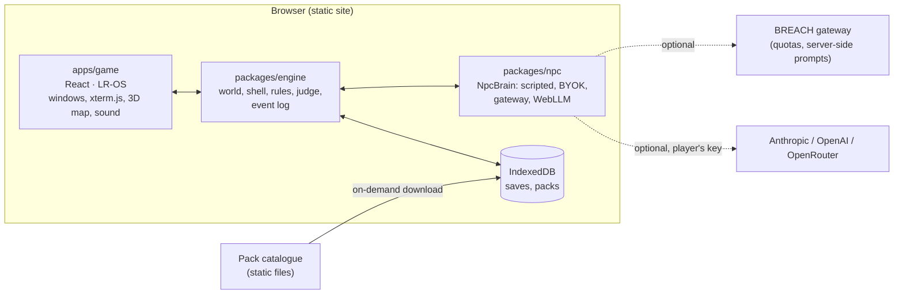
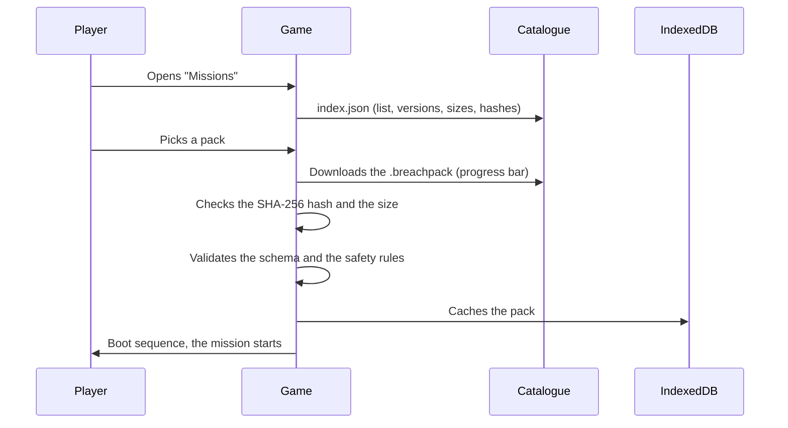

# BREACH architecture (draft)

Nov 22, 2026 · draft v0, directions approved by Marco on November 22, 2026. It answers the points raised in the [GDD review](../review/revue-gdd-2026-11.en.md).

> English translation of the [French original](architecture.md). The French version is the reference: if the two differ, follow it.

## Principles

1. **The engine does not know about the interface.** The simulated world, the shell, the mission rules and the judge are plain TypeScript, with no DOM or React. They are tested from the command line, and the interface only displays what the engine emits.
2. **Everything is an event.** Every player action and every reaction from the world is a timestamped event in a log. The game state is rebuilt from that log.
3. **Content is data, never code.** A mission, a machine, an NPC, a vulnerability and its fix are described in YAML. Official missions use exactly the same format as future community missions.
4. **Extensible on the inside, declarative on the outside.** The engine is organised into registries (commands, network services, windows, NPC brains). The team adds code through these registries. The community adds content, not code.

## Overview



## The event log, the foundation of the engine

This is the most important decision, because it serves five GDD features at once:

| GDD feature | What it reads from the log |
| --- | --- |
| Logs on NovaMind's machines | Each visible action writes a log line on the target machine (`auth.log`, `access.log`...) |
| Noise gauge and SOC detection | Noise is the weighted sum of recent events |
| Blue Team debrief | The player finds their own events, with timestamps, in the SOC console |
| Replaying the attack after a fix | The player's commands are re-run against the fixed world |
| Final pentest report and VHS "rewind" | The log tells the story of the game in order |

In practice:

- An **event** is a timestamped object: `CommandRun`, `FileRead`, `HostDiscovered`, `LoginAttempt`, `NpcMessage`, `ToolCall`, `FlagSubmitted`, `ObjectiveDone`, `ConfigPatched`...
- The **state** is `reduce(events)`. A save is a snapshot plus the events since that snapshot.
- The engine is **deterministic**: a simulated game clock and a seeded random generator. Replaying the same commands gives the same result, which makes the Blue Team replay and the tests reliable.
- The interface **subscribes** to the event stream. The "first `nmap`" moment comes from there: the command emits `HostDiscovered` as its output is written, and the 3D map lights up each node at the same moment.

## Vulnerabilities described as data

For the Blue Team fix to be a real move, a vulnerability is not a hard-coded command output. It is a condition on the world's configuration:

```yaml
# excerpt from world/hosts/hr-agent.yaml
config:
  hr_agent.sanitize_cv: false        # the vulnerability
  hr_agent.human_review: false
vulns:
  - id: cv-indirect-injection
    class: OWASP-LLM01               # prompt injection
    active_when: { all: [ { not: hr_agent.sanitize_cv }, { not: hr_agent.human_review } ] }
fixes:
  - id: enable-sanitize
    sets: { hr_agent.sanitize_cv: true }
    label: { fr: "Nettoyer les CV avant lecture", en: "Sanitize CVs before reading" }
```

The fix chosen by the player emits `ConfigPatched`, then the engine re-runs the attack's commands. The vulnerability is no longer active, the attack fails, and the player sees it in their terminal.

## The engine (packages/engine)

**Simulated world**

- **Hosts**: name, IP, OS, accounts, services, file system.
- **Virtual file system**: an in-memory tree with owners and Unix permissions (read, write, execute). Files can be static (in the pack) or generated (logs, from the event log).
- **Network**: DNS zones, routes between hosts, open ports. Any target outside the declared scope returns a refusal and an `OutOfScope` event, which triggers Ada's reminder.
- **Services**: each port is served by a protocol handler from the registry (`http`, `ssh`, `dns`, `smtp`...). An HTTP service declares pages and API routes. The fictional browser, `curl` and the Nova chatbot all go through it.

**Shell**

- Tokenizer with quotes and escapes, pipes, `>` and `>>`, `&&` and `;`, history, Tab completion. No variables or scripts in v1.
- Each command is an entry in the registry:

```ts
interface Command {
  name: string;
  summary: I18nText;                         // for `help` and `explain`
  complete?(ctx: ShellCtx, args: string[]): string[];
  run(ctx: ShellCtx, args: string[], stdin: Stream): AsyncIterable<Output | GameEvent>;
}
```

- `run` is an async generator: the command writes its output progressively, with simulated latency, and emits its events at the right moment.
- `ssh` pushes a context (host, user, directory). `exit` pops it.
- Command outputs are in English, like the real ones. Game messages are translated.

**Mission rules**

A small declarative "trigger, condition, effect" language, evaluated by the engine. It covers most mission needs without ever running code that comes from content.

```yaml
rules:
  - on: { event: FileRead, path: "/srv/repo/.git", host: dev.novamind.test }
    if: { not: flag.found.aws_key }
    do:
      - ada.say: m1.ada.look_at_history
      - noise.add: 0
  - on: { event: FlagSubmitted, flag: aws_key }
    do:
      - objective.complete: find-secret
      - checkpoint.save: after-secret
```

The possible effects form a closed list (`ada.say`, `npc.unlock`, `host.reveal`, `file.add`, `noise.add`, `objective.complete`, `checkpoint.save`, `world.set`...). Conditions are a JSON Logic-like subset, with no loops.

**Judge**

- Secrets are checked by **explicit submission** (`submit FLAG{...}`), compared against a hash stored in the pack.
- Agent missions (4 and 5) are validated by the **tool calls** an agent executes in the simulated world (`ToolCall` with admin rights).
- The LLM never decides on success.

## NPCs (packages/npc)

```ts
interface NpcBrain {
  id: 'scripted' | 'byok' | 'gateway' | 'webllm';
  reply(npc: NpcSheet, history: Turn[], input: string, signal: AbortSignal):
    AsyncIterable<{ text?: string; toolCall?: ToolCall }>;
}
```

- **Scripted**: dialogue trees, plus a detector for **families of injection techniques** (role play, contrary instructions, translation, encoding, false authority, splitting). Each guardrail level resists some of those families. Patterns run in a Web Worker with a time limit, so that a badly written regular expression cannot freeze the tab.
- **BYOK**: direct call to the provider from the browser, with the NPC sheet as the system prompt.
- **Gateway**: the browser sends the pack's identifier, the NPC's identifier and the message. The server adds the prompt. The gateway only serves reviewed packs (it knows their prompts by hash).
- **WebLLM**: experimental, loaded on demand.
- Tool calls proposed by an LLM are executed by the engine, with the rights defined in the pack. The LLM never touches the state directly.
- After a number of failures set by the mission, the game offers the scripted path.

## The interface (apps/game)

- **React + Vite + TypeScript**, with a light store (Zustand) fed by the engine's event stream.
- **Custom LR-OS window manager**: move, resize, focus, z-index, saved layout. Each window type (terminal, fictional browser, messaging, map, notebook, SOC console) is an entry in a registry.
- **Terminal**: xterm.js connected to the engine's shell, with screen reader mode enabled.
- **Network map**: a single graph model, two renderers. The 3D one (react-three-fiber) is lazy-loaded, and the 2D one is an automatic fallback on low-end machines.
- **Fictional browser**: pack pages are in Markdown with a few allowed components (form, image, table), rendered by the game. No raw HTML from a pack is ever injected into the page.
- **Sound**: Tone.js lazy-loaded, started by the click on the title screen.
- **i18n**: translation files per language for the interface, and translated text in each pack.

## Community levels: plugins or packs?

**The short answer: yes, with a system of "packs" downloaded on demand, like MyWhoosh's routes. But a pack contains data, not code.**

### Why not real JavaScript plugins

A plugin that runs its own JavaScript in the game page has access to everything the page can see. In BREACH, this is serious for three reasons:

- **BYOK keys** are in the page's storage. A single malicious pack is enough to steal them, and the CSP no longer protects anything once third-party code runs.
- **The audience** starts at 16. A plugin can display anything or open any page.
- **The "no real target" rule** cannot be checked in arbitrary code, whereas it can be checked automatically in data.

The only safe ways to run third-party code in a browser (an iframe isolated on another origin, or a JavaScript interpreter compiled to WebAssembly in a Worker) add a lot of complexity. The declarative rules language already covers almost everything a mission needs. If a real need for scripting comes up later, the way forward will be an isolated interpreter in a Worker, with no access to the DOM, the network or storage. It is not needed for v1.

### The pack: a route to download

A pack is a folder of YAML and assets, compiled into a single `.breachpack` file (a compressed archive with a manifest).

```
m3-nova-en-sait-trop/
  pack.yaml          # identity, version, engine compatibility, dependencies, languages
  world/             # hosts, services, files, web pages (Markdown)
  npcs/              # NPC sheets: personality, knowledge, taboos, guardrails per difficulty
  mission.yaml       # objectives, rules, noise, checkpoints, hints
  blueteam.yaml      # logs to find, 3 detection rules, fixes
  i18n/fr.yaml
  i18n/en.yaml
  assets/            # PNG/WebP images only, size-limited
  solution.txt       # the solution, replayed automatically in CI
```

```yaml
# pack.yaml
id: breach.official.m3
version: 1.0.0
engine: ">=1.0 <2"
requires:
  - breach.world.novamind@^1     # the world shared by the whole campaign
title: { fr: "Nova en sait trop", en: "Nova Knows Too Much" }
authors: [ "BREACH" ]
locales: [ fr, en ]
```

Two kinds of packs:

- **World packs**: a reusable fictional network (NovaMind, or another company created by the community).
- **Mission packs**: a mission built on a world. The official campaign is an ordered list of mission packs on the NovaMind world, and the world's state (compromised machines, accounts found) carries over from one mission to the next.

### The "MyWhoosh-style" flow



- The **catalogue** is a plain static `index.json`, served with the packs from a `breach-game/packs` repository published on GitHub Pages or Cloudflare Pages. No server.
- **Official missions** are preloaded by the service worker, so that the first launch stays under 30 seconds and the game works offline.
- A downloaded pack stays cached and can be played offline. A new version is offered at launch, without breaking a game in progress.
- You can also **import a `.breachpack` file** or a URL (to test your own missions), with an "unreviewed pack" warning.

### Publishing a pack

1. The author creates their pack with the CLI: `breach-pack new`, then `breach-pack dev`, which launches the game with hot reload. The JSON Schema provides autocompletion in VS Code.
2. `breach-pack build` validates and produces the `.breachpack`.
3. The author opens a pull request on `breach-game/packs`.
4. CI validates the schema, applies the safety rules, **replays `solution.txt`** to prove the mission can be finished, and checks both languages if they are declared.
5. A human review looks at tone and content, then merging publishes the pack to the catalogue with the "reviewed" badge.

A visual editor in the browser may come later. The CLI and the schema are enough for the first creators, who will mostly be technical.

### Content safety rules

| Threat | Protection |
| --- | --- |
| Code run from a pack | None possible: no JavaScript, no raw HTML, no SVG. The format has no field that executes |
| XSS through the fictional browser's pages | Markdown rendered by the game with a closed list of components. As extra defence, the fictional browser is displayed in a `sandbox` iframe without `allow-same-origin` or scripts |
| Real targets in the content | The validator rejects any domain outside `.test`, `.example`, `.invalid`, `.localhost` and any IP outside reserved ranges (RFC 5737, RFC 1918) |
| Links to the outside world | Only an allowlist is clickable (Root-Me, TryHackMe, ANSSI, OWASP...) |
| Regular expression that freezes the tab (ReDoS) | Patterns evaluated in a Worker with a time limit, and dangerous patterns rejected at validation |
| Booby-trapped or huge archive | Maximum size for the pack and for each file, capped number of files and hosts, limited decompression |
| Pack modified after review | SHA-256 hash in the catalogue, checked on download |
| Hijacking the gateway with a community prompt | The gateway only serves reviewed packs, with the prompt stored server-side. An unreviewed pack works in scripted or BYOK mode |
| Content unsuitable for a 16+ audience | Human review before the "reviewed" badge, a "report" button in the game |
| BYOK key leak | Strict CSP without `unsafe-inline` or `unsafe-eval`, Trusted Types, no third-party scripts, fonts hosted on the site |

### What about real code plugins?

The engine's registries (commands, services, windows, brains, rule effects) are the **internal** plugin API. Adding `hydra`, an `smb` protocol or a "Wireshark" window is done through a contribution to the main repository, reviewed like any other code. A pack declares the capabilities it needs (`requires_commands: [hydra]`), and the game refuses the pack if its engine version doesn't have them. We get the extensibility of plugins without running unreviewed code on players' machines.

## Saves and storage

- IndexedDB (through Dexie): saves, cached packs, preferences.
- `navigator.storage.persist()` requested on first launch, to avoid automatic eviction (Safari in particular).
- Export and import of a save file. The format is versioned, with migrations.
- BYOK key in `sessionStorage` by default, in local storage only if the player ticks "remember me".

## The gateway (later)

Proposal to settle the GDD's open question: a small API on **Cloudflare Workers** in front of the providers, with Turnstile for the anonymous token and a Durable Object for quotas. FreeLLMAPI on the VPS can stay behind it as a model source if needed. The Worker deploys for free, with no server maintenance, and keeps the public surface well separated from the VPS. It is not needed before lot 4.

## Repositories and tooling

| Repository | Content |
| --- | --- |
| `breach-game/breach` | pnpm monorepo: `packages/engine`, `packages/npc`, `packages/pack-schema`, `packages/pack-cli`, `apps/game`, `apps/gateway` (later), `content/` (official packs) |
| `breach-game/packs` | Community catalogue: one folder per pack, validation CI, publishing of `index.json` and the `.breachpack` files |
| `breach-game/docs` | GDD, mockups, architecture, decisions |
| `breach-game/.github` | Organisation profile and visual identity |

Keeping the official packs in the monorepo makes it possible to evolve the engine and the content in the same pull request while the format is not stable.

**Tooling**: strict TypeScript, Vite, Vitest for the engine, "golden" tests on command outputs, replay of each pack's `solution.txt` in CI, Playwright for screenshots at every lot, Zod for the pack schema (with JSON Schema export), GitHub Actions, deployment on Cloudflare Pages.

## Impact on the roadmap

| Lot | Proposed change |
| --- | --- |
| Lot 0 | Add: a headless engine with an event log, pack format v0, mission 0 and the start of mission 1 as packs, `nmap` lighting up a simple map, a first solution replay test |
| Lot 1 | Fictional browser, complete mission rules, noise, checkpoints, saves. The YAML format already exists |
| Lot 3 | Prototype the scripted bot based on injection families **before** writing missions 2 and 3 |
| Lot 5 | The Blue Team replay relies on the event log, already in place |
| After v1 | Opening community packs: public CLI, `packs` repository, catalogue in the game |

## Ready for new missions from v1

v1 only contains missions 0 to 3, but adding a mission must not require any change to the game. This imposes four rules from lot 0:

1. **No mission is hard-coded.** Missions 0 to 3 are packs in `content/`, compiled to `.breachpack` at build time.
2. **A single loading path.** The game reads an `index.json` and loads official packs exactly as it will load community packs (hash, validation, cache). The "Missions" screen shows what the catalogue contains.
3. **The schema is versioned from the first pack** (`engine: ">=1.0 <2"`), with the validator and the `solution.txt` replay in CI.
4. **Adding mission 4** means adding a folder in `content/` and a line in the campaign. If it needs a new command, that command is added to the engine's registry.

Official packs stay in the monorepo while the format keeps changing. The `breach-game/packs` repository will be created when the community opens up (v1.x). Nothing in the game depends on where packs are hosted: only the catalogue URL changes.

### Community opening (2026-11-22)

What was built when the community opened:

- **`breach-game/packs`** holds one folder per community pack, the guide for authors (`CONTRIBUTING.md`) and two workflows. `check.yml` runs the game's own validator (`breach-pack check --community --with content`, from `breach-game/breach` main) on every pull request and every night: schema, safety rules, translations, replay of `solution.txt` in each declared language. `publish.yml` runs after a merge: it builds the `.breachpack` files and `index.json`, **signs `index.json`** (ECDSA P-256, key in the `BREACH_SIGNING_KEY` secret) and publishes data files only on GitHub Pages.
- **The official packs stay in `breach`, pinned in the build.** Community packs never replace them: a community catalogue cannot list a `breach.*` id or a campaign.
- **The game** lists community missions on its title screen, downloads the catalogue only then, checks its signature against a public key compiled into the build (also from cache), ignores a copy older than the last one seen, then checks each pack's SHA-256 and runs the schema and safety checks. A community mission is played on its own, with its own save, in an official world (NovaMind or a season's world) or in a community world.
- **Community ids** are `<author>.<pack>`. Changing a published pack means raising its version.
- **Import from a file** (23/11/2026): `breach-pack bundle` gathers packs and their solutions; the game redoes the CI checks in the browser, keeps the file on the player's machine and shows it with the "Not reviewed" badge.
- **Not done yet:** a "report" button, a visual editor.

### Defence side (2026-11-22)

What was built so that every attack has its counter:

- **Telemetry.** The engine derives log lines from events, in the real tool's format (`access`, `auth`, `chat`, `agent`, `dns`, `ids`, `audit`, `git`, `db`, `flow`, `mail`, `mqtt`), with the true source address even through SSH hops, plus deterministic background traffic declared in the world or the mission. Every new network command must declare the telemetry it leaves.
- **Weaknesses as data.** The chosen form is simpler than the example above: a `config` of keys in the world or the mission, and the condition `{ config, eq }` on a character's intent, a commit, a flag or an attacker step. A fix or a containment is a `sets` on those keys, logged as `ConfigPatched`.
- **Defence replay of an attack mission** (`defense` block). After the debrief, the player finds their own lines, picks the detection rule (Sigma-like, with a per-source threshold) and the fix. The engine replays the player's attack in two sandboxes built from the journal, without and with the fix, and compares what it gains. A flag only counts in the replay if it first appeared in an output. The replay is required to move on in the campaign, and its points add to the score.
- **Defence missions** (`side: defense`). A scripted attacker moves one step every `pace` player commands; the player reads logs (`soc`), contains (`contain`, with a business impact cost) and answers the investigation (`answer`, checked by hash). If the attacker reaches its goal, `mission.fail` sends the player back to the last checkpoint. Three Blue Team missions follow the attack campaign. A step of the attacker that a containment refused leaves a `flow: deny` line in the logs.
- **Report.** The `report` command writes the pentest report from the journal (findings, proposed detection, verified fix, incidents and containment), downloadable as Markdown at the end of the campaign.
- **Checks.** `breach-pack check` refuses a `defense` block whose correct rule has false positives, whose wrong rule is perfect, or whose fixes do not behave as stated.

### Content after the campaign (2026-11-23)

The pack format grew with the content, and still holds no code:

- **Kinds of trials.** `checks`: conditions on the game state, most often on a file of the workstation (`{ file, contains, lacks }`), judged by the `verify` command; the player repairs with the workstation's editor (`edit <file>`, also `nano`, `vi`, `vim`, `emacs`, with a "Save and verify" button), `sed -i` or a redirection. Since engine 0.19.3 the workstation points to the editor on its own: `mission` lists the files to write or fix, `verify` prints `edit <file>` for a failing check, and hints name `edit` before `sed`. `questions`: multiple choice questions that Ada asks (`ada.ask`), shown as buttons and reachable with `answer`. A flag can also be a short answer (an address, an identifier).
- **Questions that are hard to guess.** The engine shuffles the options of a question, always the same way for a given question (the seed is the mission id and the question id), so a resumed game or a replayed solution sees the same order. Solutions answer by option id. `breach-pack check` refuses a question whose right option is more than 1.3 times as long as the longest wrong one.
- **A flag must have been shown.** The engine records every `FLAG{…}` that appears in a command output, a page, a reply or an opened file (`FlagShown` event), and `submit` refuses the others, with no penalty. What the player types does not count. Since packs are public, this stops a mission from being finished by copying its solution.
- **Series** (`kind: series`). A pack that chains 2 to 12 missions of one world in a single save: what the player did in one mission still exists in the next. The validator replays the solutions in a row, in one game.
- **"What really happened" card** (`debrief.facts`). After the fiction, a mission can tell the real incident it is inspired by, with its sources. It is the only place where a pack may write a real domain (plain `https`, shown as text, never as a link), and no private person is named. The "case files" of the `packs` repository are series built on this model.
- **Seasons** (`track: season`). Official series played outside the campaign, each in its own official world and its own save. The catalogue lists them apart. The NovaMind campaign is season 1; season 2 takes place at Halcyon. Seasons 3 to 9 are described further down.
- **Trainings** (`track: training`). Short official missions, one technique each, always open, with `difficulty` and `skills`.
- **Progress.** A save records the version of the world and of each mission. If an update changes either, finished missions are carried over with their score and their defence points (`ProgressCarried`), and the mission in progress starts again. The same event imports a progress file, read as untrusted input.

### Seasons 3 to 9 (2026-11-24)

Seven seasons followed Halcyon, each in its own world (`content/worlds/<name>`) and shipped with the engine additions it needed. None of them accepts code: everything stays data read by the engine, and no model judges.

| Season | World | Subject | Engine additions |
| --- | --- | --- | --- |
| 3 | Pélican, an online shop | Classic web flaws | 0.6: page blocks `form` and `table`, input shapes on an intent (`input: quote, markup, negative`), route `variants` (cookie, header), `jq`, `jwt decode`, code review (`reviews`, `review`) |
| 4 | Town of Corbelle | Ransomware, defence only | 0.7: decisions (a question with no right answer, `impact`, `sets`, the `choice` condition), `crontab -l`, measures `remove`, `restore`, `rotate` that rewrite or delete files, rules written by the player (`hunts`, `rule test`), a `startTime` per mission |
| 5 | Sélène, teams of AI agents | Shared index, poisoned memory, invented package, impersonation between agents | 0.8: guardrails written by the player (`evals`, `eval run`), the `|gte` modifier |
| 6 | Alto, on a fictional cloud | Public storage, pipeline token, role too wide, consent | 0.9: a route variant with a condition alone |
| 7 | Festival Lumière Noire | Bug bounty, disclosure, phishing | 0.10: the `mail` log |
| 8 | Verdure, a vertical farm | Connected devices | 0.11: the `mqtt sub|pub` command (a topic is a route of a host that carries an `mqtt` service), the `mqtt` log |
| 9 | Ligne Rouge | Finale: Mute logs in at the firm through an account never closed | none: the finale only uses what exists |

What these additions have in common:

- **Recognise a class of flaw, never a payload.** A form is a scripted character without a face; an intent can require a shape of input (a quote, a tag, a negative number), not an exact string. The pack safety check still refuses `<script`, `javascript:` and `on…=` attributes.
- **The player writes, the engine counts.** A detection rule passes when it alerts on every targeted line of the attacker and on no line of ordinary activity (`runDetection`). An agent guardrail passes when it blocks every case to block and no legitimate case (`runEval`). The cases are data: nothing is run.
- **Decisions with no right answer.** Each option has a price (`impact`) and stays recorded in the state for the whole save; a later mission of the series reads it (`choice`), which gives branching endings. The validator replays the solution once per option.
- **New protocols reuse routes.** The storage and identities of the fictional cloud are web routes; a message broker is a host whose routes are topics. `mqtt` goes through the same scope gate as `curl`, never stays subscribed and leaves its own log line.
- **A path between seasons.** The title screen suggests the next step (resume, start the next season), and what is new is decided on the player's machine, with no tracking.
- **A thread running through, as data.** Each world of seasons 3 to 8 serves a `/m.txt` route, Mute's calling card; their parts spell the name of the account the finale has the player close. Mute is never named or arrested: attribution goes to a signature, not to a person.

### Content expansion (24/11/2026)

After season 9, a plan listed the coverage gaps (enterprise identity, patching, session theft, email, containers, mobile, host forensics, resilience with no attacker, AI governance) and filled them with two engine lots and community content.

| Version | Engine additions |
| --- | --- |
| 0.12 | Paths (`kind: path`, 3 to 20 steps to official or community missions) and levels allowed per pack (`levels: [expert]`, the engine falls back to the nearest allowed level) |
| 0.13 (lot A) | Non-text files described as data (`$binary`, `$archive`, `$cert`), `strings`, `file`, `unzip`, `tar`, `openssl x509` and `dgst`, `hashid`, `sbom [--vuln]` with fictional advisories, `mailhdr`, threshold rules (`count`, `within`, `by`), a `call` channel to a character with a fictional number |
| 0.14 (lot B) | What a machine runs (`ps`, `ss`, `systemctl`, `journalctl`, `last`), `flows` (the firewall log summed up), read-only `kubectl get/describe/logs`, `ldapsearch` on a directory described as data, releases (`deploy`, `rollback`, `flag set`), `timelines` and `paths` objectives |
| 0.15, 0.16 | Binary members inside an archive (mobile app), the `mobile` skill, a `directory.anonymous` condition a fix can close |

The content, all in `breach-game/packs` except the trainings:

- **Case files 13 to 32.** Twenty new series inspired by real incidents (Okta, Replit, Air Canada, Polyfill, Samsung, LastPass, tj-actions, Equifax, 23andMe, Snowflake, Arup, CrowdStrike, Log4Shell, Heartbleed, MOVEit, Storm-0558, SolarWinds, Mirai, Oldsmar, NotPetya). High-risk cases are played on the defence side only, from a victim's seat: inventory, detection rule, containment, rebuild, with no reusable attack chain. The Oldsmar card says the facts have since been disputed.
- **Nine fictional side series**: The look-alike domain, The Friday patch, The Vault, Bench 42, Black Tuesday, Orchestra (Kubernetes), The App (mobile), Shadow AI, The Directory.
- **Challenges**: six missions in Expert only (`levels: [expert]`), with no Ada and no hint.
- **First steps and paths**: a difficulty-1 collection and four paths (First steps, OWASP Web, OWASP LLM, SOC), shown in the community store.
- **Twelve official trainings** (`content/trainings/`), one per tool added since season 3.
- **Author kit**: `CONTRIBUTING.md` updated for every new format.

CI replayed every mission in each language, and each one was played end to end in the browser before it was merged.


### The house, APIs and case files 33 to 40 (2026-11-24)

A coverage check listed what was still missing: the connected home and personal security, APIs, and a few very well known real incidents. Two official seasons and a new wave of community content cover them.

| Version | Engine additions |
| --- | --- |
| 0.17 | `nmcli device wifi list` (the `wifi` table of the world and of the mission: the passive list seen from the workstation, "locally administered" hardware addresses, an `if` condition a fix can flip, no capture and no connection), `sms` (the `sms` inbox, the kind of sender and the site each link opens), the `debrief.home` card "To do at home" |

| Season | World | Subject | What it uses |
| --- | --- | --- | --- |
| 10 | The Lemerle family home | A weekend at a family's house, on the defence side with the agreement of the people who live there: network inventory, router and Wi-Fi settings, a camera opened by a reused password, a Zigbee and Z-Wave hub, text message scams and a cloned voice, the mailbox and a forwarding rule, a smart plug that talks at night | 0.17, `mqtt`, `call`, `flows`, a rule written by the player. The world follows the file the player fixes (`{ file, contains }` conditions on routes and on the `wifi` table) |
| 11 | Comptoir, a neobank | The classes of the OWASP API Security Top 10: a version retired on paper, an account served without checking its owner, a text message code with no attempt limit, a request to an internal address, an OAuth return address compared with "contains", a referral programme stormed by valid requests | no addition: `unzip`, `strings`, a threshold rule `by: path`, `flag set`, `timeline`, a decision |

What both seasons keep to:

- **No real device model, no radio command.** The player reads what the hub publishes on its `mqtt` topics (pairing left open, a lock paired without encryption); nothing is transmitted or captured.
- **Numbers and addresses reserved for fiction.** The schema refuses any phone number outside the fictional ranges and any hardware address that could belong to a manufacturer.
- **The consent and notification servers are scripted characters.** They recognise the shape of a request, never a payload; the proof is made on a test account, the real customer costs noise.
- **Things to do again at home.** Every debrief of season 10 carries a `debrief.home` card.

The community content, in `breach-game/packs`:

- **Case files 33 to 40.** Eight defence-side series inspired by real incidents: Ring, British Airways, Optus, Target, Verkada, Twilio (0ktapus), Colonial Pipeline, MyEtherWallet (BGP hijack). Each card states only what the sources read say.
- **Three fictional side series**, twelve in all: The Badge (physical security: a held door, a lost badge, a USB stick found), The Weights (AI security: model weights in an open bucket, a browsing agent that reads a booby-trapped page, a confident wrong answer, consumption with no cap), The Tag (being tracked by someone close, seen only from the side of the person tracked, on their own devices and with their agreement, with no surveillance technique; the "To do at home" cards point to helplines).
- **Three Challenges**, nine in all: an origin allowed too widely (CORS), an uploaded file that is not a picture, a token issued for another application.
- **A fifth path**, "Securing your home": two trainings, season 10, four case files and The Tag.
- **Author kit**: `CONTRIBUTING.md` describes `wifi`, `sms` and `debrief.home`.


### Public Wi-Fi and QR codes (24/11/2026)

A question from Marco: is watching what someone does on a public Wi-Fi still current? The plan answered honestly: reading content has become rare (HTTPS covers almost everything), but the fake network that asks for a password, the metadata (DNS, SNI), devices that still talk in clear, the other guests on the same network and the traveller's habits are still real. QR codes, everywhere and never checked, came next.

| Version | Engine additions |
| --- | --- |
| 0.18 | `$capture` (a capture already taken, packets `dns`, `tls`, `quic`, `http`, `arp`, `dhcp`, `smb`, `tcp`, `udp`) read by `tshark -r [-Y] [-V] [-q -z conv]`: encrypted traffic only exists through its size, no live capture; `$qr` (the picture of a QR code) read by `qr decode` and `zbarimg`, drawn by `qr show` in an image viewer (SVG, readable by a phone); `nmcli connection show|delete|modify` on the workstation's saved networks; `wlan` log of a wireless controller (`managed`); `attach` field of the `mail` log; `debrief.home` card with `kind: travel` ("To do on the road") |

The content:

- **Training 13**, "What travels in clear": reading a capture of a guest Wi-Fi.
- **Side series The Sticker** (QR codes, defence side): a sticker on parking meters, a parcel that makes you install an app, a mail with no link but a QR picture, the town's posters whose shortener domain was bought again.
- **Side series L'Escale** (public Wi-Fi, audit and defence): the capture that brings down the myth, the fake "5G" network seen in the controller's log (facts card: the Australian Federal Police case, 2024), the other guests and client isolation (which can be bypassed, AirSnitch research 2026), then saved networks and what Enhanced Open brings.
- **Path "On the road"**: t13, both side series, t04 and case file 38.

What deliberately does not exist: no fake access point built by the player, no disconnection, no key cracking, no live capture. Travellers' devices are seen, never touched.

### Third lot: clipboard, apps made with an AI (24/11/2026)

A third coverage analysis looked for what was still missing. Marco approved its recommendations: one last targeted lot, then quality.

| Version | Engine additions |
| --- | --- |
| 0.19 | page block `copy` (a text put in the game's clipboard, never the real one) and `clip` (with `xclip -o`, `xsel -b -o`, `pbpaste`, `wl-paste`) that shows it without running anything; the copied text must be a fictional tool of the world (shells, downloads, encodings and pipes are refused); `$image` read by `exiftool` (`-gps:all=`, `-all=`, `<file>_original`); host cache `cdn` and route `loose` (web cache deception); `curl -Z` and a character's `serial` condition (the race); log source `signin` for an identity provider; `bcc` field of the `mail` log |

The content:

- **Trainings 14 and 15**: what a photo says (`exiftool`), an AI assistant's share link.
- **Side series The Clipboard** (ClickFix, defence side): a third-party widget's fake check, what it put in the clipboard read with `clip`, the machines that pasted it, a rule on the command line, then a content policy judged by `verify`.
- **Case files 41 to 46**: Salesloft Drift (a connector's tokens), the first malicious MCP server (postmark-mcp), McHire's test account (audit under mandate), the fake remote hire (KnowBe4), device code phishing (Storm-2372), the hijacked browser extension (Cyberhaven).
- **Two challenges**: the deceived cache and the race (a gift card credited twice).
- **Season 12, "The prototype"**, official and with no new engine feature: Coup de main, a help app written in a weekend with a coding assistant. The database's public key and schema served to all, profiles readable for lack of row rules (CVE-2025-48757 facts card), an administrator demo account, a shared conversation holding the service key, reviewing the generated code, then row rules written in a file the database follows, and a decision on telling the neighbours.

Left aside: ConnectWise (facts still moving), Shai-Hulud (duplicates Halcyon), and still XXE, deserialisation, SSTI and request smuggling (too close to a payload).

## Architecture decisions

Approved by Marco on November 22, 2026.

- [x] Event log and deterministic engine as the foundation.
- [x] 100% declarative content, no third-party code executed.
- [x] Packs downloaded on demand from a static catalogue, reviewed through pull requests. The loading mechanism is in place from v1.
- [x] Community catalogue in `breach-game/packs`, signed at publication, checked by the game with a compiled-in key (2026-11-22).
- [x] pnpm monorepo in `breach-game/breach`, separate `packs` repository created when the community opens up.
- [x] Gateway on Cloudflare Workers, after v1.
- [x] Defence replay required to finish a mission (skippable in "Replay a mission"), defence missions where Ligne Rouge holds the incident response contract, defence score counted in the mission score (2026-11-22).
