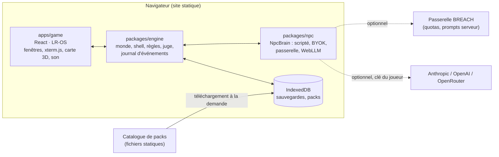
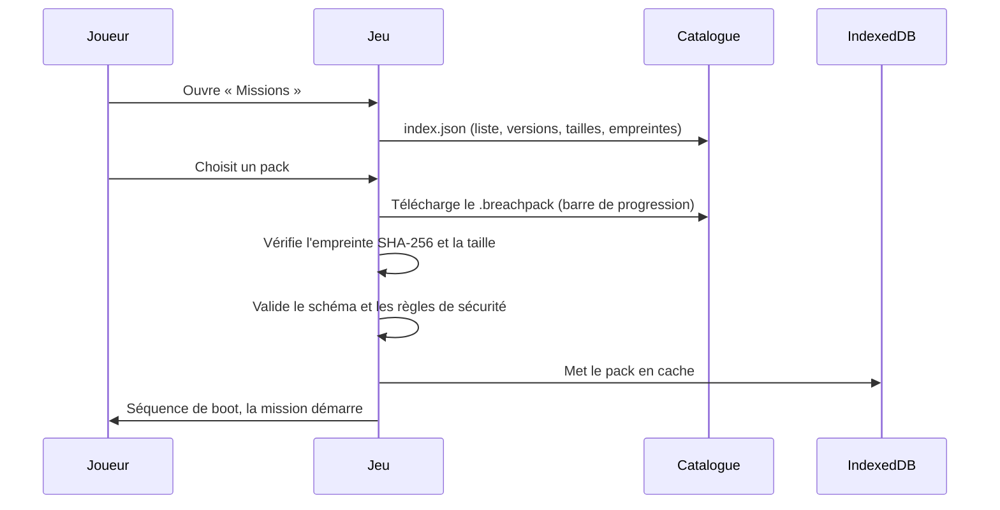

# Architecture de BREACH (draft)

Nov 22, 2026 · draft v0, à discuter avant le lot 0. Il répond aux points de la [revue du GDD](../review/revue-gdd-2026-11.md).

## Principes

1. **Le moteur ne connaît pas l'interface.** Le monde simulé, le shell, les règles de mission et le juge sont du TypeScript pur, sans DOM ni React. Ils se testent en ligne de commande, et l'interface ne fait qu'afficher ce que le moteur émet.
2. **Tout est un événement.** Chaque action du joueur et chaque réaction du monde est un événement daté dans un journal. L'état du jeu se reconstruit à partir de ce journal.
3. **Le contenu est une donnée, jamais du code.** Une mission, une machine, un PNJ, une faille et son correctif sont décrits en YAML. Les missions officielles utilisent exactement le même format que les futures missions communautaires.
4. **Extensible à l'intérieur, déclaratif à l'extérieur.** Le moteur est organisé en registres (commandes, services réseau, fenêtres, cerveaux de PNJ). L'équipe ajoute du code par ces registres. La communauté ajoute du contenu, pas de code.

## Vue d'ensemble



## Le journal d'événements, fondation du moteur

C'est la décision la plus importante, parce qu'elle sert cinq fonctionnalités du GDD à la fois :

| Fonctionnalité du GDD | Ce qu'elle lit dans le journal |
| --- | --- |
| Logs des machines de NovaMind | Chaque action visible écrit une ligne de log sur la machine visée (`auth.log`, `access.log`...) |
| Jauge de bruit et détection du SOC | Le bruit est la somme pondérée des événements récents |
| Débrief Blue Team | Le joueur retrouve ses propres événements, avec horodatage, dans la console du SOC |
| Rejouer l'attaque après correctif | Les commandes du joueur sont réexécutées contre le monde corrigé |
| Rapport de pentest final et « rembobinage » VHS | Le journal raconte la partie dans l'ordre |

Concrètement :

- Un **événement** est un objet daté : `CommandRun`, `FileRead`, `HostDiscovered`, `LoginAttempt`, `NpcMessage`, `ToolCall`, `FlagSubmitted`, `ObjectiveDone`, `ConfigPatched`...
- L'**état** est `réduire(événements)`. Une sauvegarde est un instantané plus les événements depuis cet instantané.
- Le moteur est **déterministe** : horloge de jeu simulée et générateur aléatoire à graine. Rejouer les mêmes commandes donne le même résultat, ce qui rend le rejeu Blue Team et les tests fiables.
- L'interface **s'abonne** au flux d'événements. Le moment « premier `nmap` » vient de là : la commande émet `HostDiscovered` au fil de sa sortie, et la carte 3D allume chaque nœud au même instant.

## Les failles décrites comme des données

Pour que le correctif Blue Team soit un vrai geste, une faille n'est pas une sortie de commande écrite en dur. C'est une condition sur la configuration du monde :

```yaml
# extrait de world/hosts/hr-agent.yaml
config:
  hr_agent.sanitize_cv: false        # la faille
  hr_agent.human_review: false
vulns:
  - id: cv-indirect-injection
    class: OWASP-LLM01               # injection de prompt
    active_when: { all: [ { not: hr_agent.sanitize_cv }, { not: hr_agent.human_review } ] }
fixes:
  - id: enable-sanitize
    sets: { hr_agent.sanitize_cv: true }
    label: { fr: "Nettoyer les CV avant lecture", en: "Sanitize CVs before reading" }
```

Le correctif choisi par le joueur émet `ConfigPatched`, puis le moteur réexécute les commandes de l'attaque. La faille n'est plus active, l'attaque échoue, et le joueur le voit dans son terminal.

## Le moteur (packages/engine)

**Monde simulé**

- **Hôtes** : nom, IP, OS, comptes, services, système de fichiers.
- **Système de fichiers virtuel** : arbre en mémoire avec propriétaires et permissions Unix (lecture, écriture, exécution). Les fichiers peuvent être statiques (dans le pack) ou générés (les logs, à partir du journal).
- **Réseau** : zones DNS, routes entre hôtes, ports ouverts. Toute cible hors du périmètre déclaré renvoie un refus et un événement `OutOfScope`, qui déclenche le rappel d'Ada.
- **Services** : chaque port est servi par un gestionnaire de protocole du registre (`http`, `ssh`, `dns`, `smtp`...). Un service HTTP déclare des pages et des routes d'API. Le navigateur fictif, `curl` et le chatbot Nova passent tous par lui.

**Shell**

- Tokeniseur avec guillemets et échappements, pipes, `>` et `>>`, `&&` et `;`, historique, complétion avec Tab. Pas de variables ni de scripts en v1.
- Chaque commande est une entrée du registre :

```ts
interface Command {
  name: string;
  summary: I18nText;                         // pour `help` et `explain`
  complete?(ctx: ShellCtx, args: string[]): string[];
  run(ctx: ShellCtx, args: string[], stdin: Stream): AsyncIterable<Output | GameEvent>;
}
```

- `run` est un générateur asynchrone : la commande écrit sa sortie au fil, avec une latence simulée, et émet ses événements au bon moment.
- `ssh` empile un contexte (hôte, utilisateur, répertoire). `exit` le dépile.
- Les sorties des commandes sont en anglais, comme les vraies. Les messages du jeu sont traduits.

**Règles de mission**

Un petit langage déclaratif « déclencheur, condition, effet », évalué par le moteur. Il couvre l'essentiel des besoins de mission sans jamais exécuter de code venu du contenu.

```yaml
rules:
  - on: { event: FileRead, path: "/srv/repo/.git", host: dev.novamind.test }
    if: { not: flag.found.aws_key }
    do:
      - ada.say: m1.ada.look_at_history
      - noise.add: 0
  - on: { event: FlagSubmitted, flag: aws_key }
    do:
      - objective.complete: find-secret
      - checkpoint.save: after-secret
```

Les effets possibles forment une liste fermée (`ada.say`, `npc.unlock`, `host.reveal`, `file.add`, `noise.add`, `objective.complete`, `checkpoint.save`, `world.set`...). Les conditions sont un sous-ensemble à la JSON Logic, sans boucles.

**Juge**

- Les secrets sont vérifiés par **soumission explicite** (`submit FLAG{...}`), comparée à une empreinte stockée dans le pack.
- Les missions d'agents (4 et 5) sont validées par les **appels d'outils** qu'un agent exécute dans le monde simulé (`ToolCall` avec les droits admin).
- Le LLM ne décide jamais d'une réussite.

## Les PNJ (packages/npc)

```ts
interface NpcBrain {
  id: 'scripted' | 'byok' | 'gateway' | 'webllm';
  reply(npc: NpcSheet, history: Turn[], input: string, signal: AbortSignal):
    AsyncIterable<{ text?: string; toolCall?: ToolCall }>;
}
```

- **Scripté** : arbres de dialogue, plus un détecteur de **familles de techniques** d'injection (jeu de rôle, instructions contraires, traduction, encodage, fausse autorité, découpage). Chaque niveau de garde-fou résiste à certaines familles. Les motifs tournent dans un Web Worker avec un délai maximum, pour qu'une expression régulière mal écrite ne bloque pas l'onglet.
- **BYOK** : appel direct au fournisseur depuis le navigateur, avec la fiche du PNJ comme prompt système.
- **Passerelle** : le navigateur envoie l'identifiant du pack, du PNJ et le message. Le serveur ajoute le prompt. La passerelle ne sert que les packs relus (elle connaît leurs prompts par empreinte).
- **WebLLM** : expérimental, chargé à la demande.
- Les appels d'outils proposés par un LLM sont exécutés par le moteur, avec les droits définis dans le pack. Le LLM ne touche jamais l'état directement.
- Après un nombre d'échecs défini par la mission, le jeu propose le chemin scripté.

## L'interface (apps/game)

- **React + Vite + TypeScript**, avec un store léger (Zustand) alimenté par le flux d'événements du moteur.
- **Gestionnaire de fenêtres LR-OS** maison : déplacer, redimensionner, focus, z-index, disposition sauvegardée. Chaque type de fenêtre (terminal, navigateur fictif, messagerie, carte, carnet, console SOC) est une entrée d'un registre.
- **Terminal** : xterm.js branché sur le shell du moteur, mode lecteur d'écran activé.
- **Carte réseau** : un seul modèle de graphe, deux rendus. La 3D (react-three-fiber) est chargée en différé, et le rendu 2D sert de repli automatique sur les petites machines.
- **Navigateur fictif** : les pages des packs sont en Markdown avec quelques composants autorisés (formulaire, image, tableau), rendues par le jeu. Aucun HTML brut venu d'un pack n'est injecté dans la page.
- **Son** : Tone.js chargé en différé, démarré par le clic de l'écran titre.
- **i18n** : fichiers de traduction par langue pour l'interface, et textes traduits dans chaque pack.

## Les niveaux communautaires : plugins ou packs ?

**La réponse courte : oui, avec un système de « packs » téléchargés à la demande, comme les circuits de MyWhoosh. Mais un pack contient des données, pas du code.**

### Pourquoi pas de vrais plugins en JavaScript

Un plugin qui exécute son propre JavaScript dans la page du jeu a accès à tout ce que la page voit. Dans BREACH, c'est grave pour trois raisons :

- **Les clés BYOK** sont dans le stockage de la page. Un seul pack malveillant suffit à les voler, et la CSP ne protège plus rien dès qu'on exécute du code tiers.
- **Le public** commence à 16 ans. Un plugin peut afficher n'importe quoi ou ouvrir n'importe quelle page.
- **Le cadre « aucune cible réelle »** ne se vérifie pas dans du code arbitraire, alors qu'il se vérifie automatiquement dans des données.

Les seules façons sûres de faire tourner du code tiers dans un navigateur (iframe isolée sur une autre origine, ou interpréteur JavaScript compilé en WebAssembly dans un Worker) ajoutent beaucoup de complexité. Le langage de règles déclaratif couvre déjà presque tout ce qu'une mission demande. Si un vrai besoin de script apparaît plus tard, la voie sera un interpréteur isolé dans un Worker, sans accès au DOM, au réseau ni au stockage. Ce n'est pas utile pour la v1.

### Le pack : un circuit à télécharger

Un pack est un dossier de YAML et d'assets, compilé en un seul fichier `.breachpack` (une archive compressée avec un manifeste).

```
m3-nova-en-sait-trop/
  pack.yaml          # identité, version, compatibilité moteur, dépendances, langues
  world/             # hôtes, services, fichiers, pages web (Markdown)
  npcs/              # fiches PNJ : personnalité, savoir, interdits, garde-fous par difficulté
  mission.yaml       # objectifs, règles, bruit, checkpoints, indices
  blueteam.yaml      # logs à retrouver, 3 règles de détection, correctifs
  i18n/fr.yaml
  i18n/en.yaml
  assets/            # images PNG/WebP uniquement, taille limitée
  solution.txt       # la solution, rejouée automatiquement en CI
```

```yaml
# pack.yaml
id: breach.official.m3
version: 1.0.0
engine: ">=1.0 <2"
requires:
  - breach.world.novamind@^1     # le monde partagé par toute la campagne
title: { fr: "Nova en sait trop", en: "Nova Knows Too Much" }
authors: [ "BREACH" ]
locales: [ fr, en ]
```

Deux types de packs :

- **Packs de monde** : un réseau fictif réutilisable (NovaMind, ou une autre entreprise créée par la communauté).
- **Packs de mission** : une mission qui s'appuie sur un monde. La campagne officielle est une liste ordonnée de packs de mission sur le monde NovaMind, et l'état du monde (machines compromises, comptes trouvés) passe d'une mission à l'autre.

### Le parcours « à la MyWhoosh »



- Le **catalogue** est un simple `index.json` statique, servi avec les packs depuis un dépôt `breach-game/packs` publié sur GitHub Pages ou Cloudflare Pages. Pas de serveur.
- Les **missions officielles** sont pré-chargées par le service worker, pour que le premier lancement reste sous 30 secondes et que le jeu fonctionne hors ligne.
- Un pack téléchargé reste en cache et se joue hors ligne. Une nouvelle version est proposée au lancement, sans casser une partie en cours.
- On peut aussi **importer un fichier** `.breachpack` ou une URL (pour tester ses propres missions), avec un avertissement « pack non relu ».

### Publier un pack

1. L'auteur crée son pack avec le CLI : `breach-pack new`, puis `breach-pack dev` qui lance le jeu avec rechargement à chaud. Le schéma JSON donne l'autocomplétion dans VS Code.
2. `breach-pack build` valide et produit le `.breachpack`.
3. L'auteur ouvre une pull request sur `breach-game/packs`.
4. La CI valide le schéma, applique les règles de sécurité, **rejoue `solution.txt`** pour prouver que la mission se termine, et vérifie les deux langues si elles sont déclarées.
5. Une relecture humaine regarde le ton et le contenu, puis la fusion publie le pack dans le catalogue avec le badge « relu ».

Un éditeur visuel dans le navigateur peut venir plus tard. Le CLI et le schéma suffisent pour les premiers créateurs, qui seront plutôt techniques.

### Règles de sécurité du contenu

| Menace | Protection |
| --- | --- |
| Code exécuté depuis un pack | Aucun : pas de JavaScript, pas de HTML brut, pas de SVG. Le format n'a pas de champ qui s'exécute |
| XSS via les pages du navigateur fictif | Markdown rendu par le jeu avec une liste fermée de composants. En défense supplémentaire, le navigateur fictif s'affiche dans une iframe `sandbox` sans `allow-same-origin` ni scripts |
| Vraies cibles dans le contenu | Le validateur refuse tout domaine hors `.test`, `.example`, `.invalid`, `.localhost` et toute IP hors plages réservées (RFC 5737, RFC 1918) |
| Liens vers l'extérieur | Seule une liste blanche est cliquable (Root-Me, TryHackMe, ANSSI, OWASP...) |
| Expression régulière qui bloque l'onglet (ReDoS) | Motifs évalués dans un Worker avec délai, et refus des motifs dangereux à la validation |
| Archive piégée ou énorme | Taille maximale du pack et de chaque fichier, nombre de fichiers et d'hôtes plafonnés, décompression limitée |
| Pack modifié après relecture | Empreinte SHA-256 dans le catalogue, vérifiée au téléchargement |
| Détourner la passerelle avec un prompt communautaire | La passerelle ne sert que les packs relus, avec le prompt stocké côté serveur. Un pack non relu fonctionne en scripté ou en BYOK |
| Contenu inadapté aux 16 ans et plus | Relecture humaine avant le badge « relu », bouton « signaler » dans le jeu |
| Fuite des clés BYOK | CSP stricte sans `unsafe-inline` ni `unsafe-eval`, Trusted Types, aucun script tiers, polices hébergées sur le site |

### Et les vrais plugins de code ?

Les registres du moteur (commandes, services, fenêtres, cerveaux, effets de règles) sont l'API de plugins **interne**. Ajouter `hydra`, un protocole `smb` ou une fenêtre « Wireshark » se fait par une contribution au dépôt principal, relue comme tout le code. Un pack déclare les capacités dont il a besoin (`requires_commands: [hydra]`), et le jeu refuse le pack si sa version du moteur ne les a pas. On obtient l'extensibilité des plugins sans exécuter de code non relu chez les joueurs.

## Sauvegarde et stockage

- IndexedDB (via Dexie) : sauvegardes, packs en cache, préférences.
- `navigator.storage.persist()` demandé au premier lancement, pour éviter l'effacement automatique (Safari en particulier).
- Export et import d'un fichier de sauvegarde. Le format est versionné, avec des migrations.
- Clé BYOK en `sessionStorage` par défaut, en stockage local seulement si le joueur coche « se souvenir ».

## La passerelle (plus tard)

Proposition pour trancher la question ouverte du GDD : une petite API sur **Cloudflare Workers** devant les fournisseurs, avec Turnstile pour le jeton anonyme et un Durable Object pour les quotas. FreeLLMAPI sur le VPS peut rester derrière comme source de modèles si besoin. Le Worker se déploie gratuitement, sans maintenance de serveur, et sépare bien la surface publique du VPS. Elle n'est pas nécessaire avant le lot 4.

## Dépôts et outillage

| Dépôt | Contenu |
| --- | --- |
| `breach-game/breach` | Monorepo pnpm : `packages/engine`, `packages/npc`, `packages/pack-schema`, `packages/pack-cli`, `apps/game`, `apps/gateway` (plus tard), `content/` (packs officiels) |
| `breach-game/packs` | Catalogue communautaire : un dossier par pack, CI de validation, publication de `index.json` et des `.breachpack` |
| `breach-game/docs` | GDD, maquettes, architecture, décisions |
| `breach-game/.github` | Profil de l'organisation et identité visuelle |

Garder les packs officiels dans le monorepo permet de faire évoluer moteur et contenu dans la même pull request tant que le format n'est pas stable.

**Outillage** : TypeScript strict, Vite, Vitest pour le moteur, tests « golden » sur les sorties de commandes, rejeu des `solution.txt` de chaque pack en CI, Playwright pour des captures d'écran à chaque lot, Zod pour le schéma des packs (avec export en JSON Schema), GitHub Actions, déploiement sur Cloudflare Pages.

## Effets sur la roadmap

| Lot | Changement proposé |
| --- | --- |
| Lot 0 | Ajouter : moteur sans interface avec journal d'événements, format de pack v0, mission 0 et début de mission 1 en pack, `nmap` qui allume une carte simple, premier test de rejeu de solution |
| Lot 1 | Navigateur fictif, règles de mission complètes, bruit, checkpoints, sauvegarde. Le format YAML existe déjà |
| Lot 3 | Prototype du bot scripté par familles d'injection **avant** d'écrire les missions 2 et 3 |
| Lot 5 | Le rejeu Blue Team s'appuie sur le journal, déjà en place |
| Après v1 | Ouverture des packs communautaires : CLI public, dépôt `packs`, catalogue dans le jeu |

## Décisions d'architecture à valider

- [ ] Journal d'événements et moteur déterministe comme fondation (proposé).
- [ ] Contenu 100 % déclaratif, aucun code tiers exécuté (proposé).
- [ ] Packs téléchargés à la demande depuis un catalogue statique, avec relecture par pull request (proposé).
- [ ] Monorepo pnpm dans `breach-game/breach`, dépôt `packs` séparé créé à l'ouverture communautaire (proposé).
- [ ] Passerelle sur Cloudflare Workers, après la v1 (proposé).
