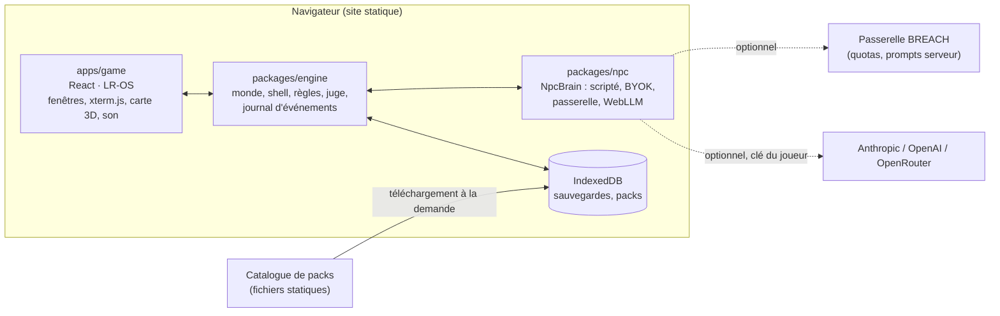
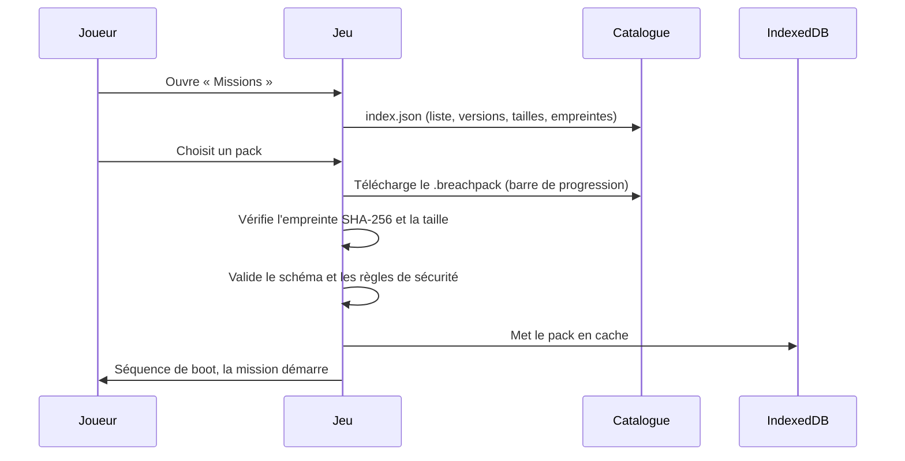

# Architecture de BREACH (draft)

Nov 22, 2026 · draft v0, orientations validées par Marco le 22 novembre 2026. Il répond aux points de la [revue du GDD](../review/revue-gdd-2026-11.md).

## Principes

1. **Le moteur ne connaît pas l'interface.** Le monde simulé, le shell, les règles de mission et le juge sont du TypeScript pur, sans DOM ni React. Ils se testent en ligne de commande, et l'interface ne fait qu'afficher ce que le moteur émet.
2. **Tout est un événement.** Chaque action du joueur et chaque réaction du monde est un événement daté dans un journal. L'état du jeu se reconstruit à partir de ce journal.
3. **Le contenu est une donnée, jamais du code.** Une mission, une machine, un PNJ, une faille et son correctif sont décrits en YAML. Les missions officielles utilisent exactement le même format que les futures missions communautaires.
4. **Extensible à l'intérieur, déclaratif à l'extérieur.** Le moteur est organisé en registres (commandes, services réseau, fenêtres, cerveaux de PNJ). L'équipe ajoute du code par ces registres. La communauté ajoute du contenu, pas de code.

## Vue d'ensemble



## Le journal d'événements, fondation du moteur

C'est la décision la plus importante, parce qu'elle sert cinq fonctionnalités du GDD à la fois :

| Fonctionnalité du GDD | Ce qu'elle lit dans le journal |
| --- | --- |
| Logs des machines de NovaMind | Chaque action visible écrit une ligne de log sur la machine visée (`auth.log`, `access.log`...) |
| Jauge de bruit et détection du SOC | Le bruit est la somme pondérée des événements récents |
| Débrief Blue Team | Le joueur retrouve ses propres événements, avec horodatage, dans la console du SOC |
| Rejouer l'attaque après correctif | Les commandes du joueur sont réexécutées contre le monde corrigé |
| Rapport de pentest final et « rembobinage » VHS | Le journal raconte la partie dans l'ordre |

Concrètement :

- Un **événement** est un objet daté : `CommandRun`, `FileRead`, `HostDiscovered`, `LoginAttempt`, `NpcMessage`, `ToolCall`, `FlagSubmitted`, `ObjectiveDone`, `ConfigPatched`...
- L'**état** est `réduire(événements)`. Une sauvegarde est un instantané plus les événements depuis cet instantané.
- Le moteur est **déterministe** : horloge de jeu simulée et générateur aléatoire à graine. Rejouer les mêmes commandes donne le même résultat, ce qui rend le rejeu Blue Team et les tests fiables.
- L'interface **s'abonne** au flux d'événements. Le moment « premier `nmap` » vient de là : la commande émet `HostDiscovered` au fil de sa sortie, et la carte 3D allume chaque nœud au même instant.

## Les failles décrites comme des données

Pour que le correctif Blue Team soit un vrai geste, une faille n'est pas une sortie de commande écrite en dur. C'est une condition sur la configuration du monde :

```yaml
# extrait de world/hosts/hr-agent.yaml
config:
  hr_agent.sanitize_cv: false        # la faille
  hr_agent.human_review: false
vulns:
  - id: cv-indirect-injection
    class: OWASP-LLM01               # injection de prompt
    active_when: { all: [ { not: hr_agent.sanitize_cv }, { not: hr_agent.human_review } ] }
fixes:
  - id: enable-sanitize
    sets: { hr_agent.sanitize_cv: true }
    label: { fr: "Nettoyer les CV avant lecture", en: "Sanitize CVs before reading" }
```

Le correctif choisi par le joueur émet `ConfigPatched`, puis le moteur réexécute les commandes de l'attaque. La faille n'est plus active, l'attaque échoue, et le joueur le voit dans son terminal.

## Le moteur (packages/engine)

**Monde simulé**

- **Hôtes** : nom, IP, OS, comptes, services, système de fichiers.
- **Système de fichiers virtuel** : arbre en mémoire avec propriétaires et permissions Unix (lecture, écriture, exécution). Les fichiers peuvent être statiques (dans le pack) ou générés (les logs, à partir du journal).
- **Réseau** : zones DNS, routes entre hôtes, ports ouverts. Toute cible hors du périmètre déclaré renvoie un refus et un événement `OutOfScope`, qui déclenche le rappel d'Ada.
- **Services** : chaque port est servi par un gestionnaire de protocole du registre (`http`, `ssh`, `dns`, `smtp`...). Un service HTTP déclare des pages et des routes d'API. Le navigateur fictif, `curl` et le chatbot Nova passent tous par lui.

**Shell**

- Tokeniseur avec guillemets et échappements, pipes, `>` et `>>`, `&&` et `;`, historique, complétion avec Tab. Pas de variables ni de scripts en v1.
- Chaque commande est une entrée du registre :

```ts
interface Command {
  name: string;
  summary: I18nText;                         // pour `help` et `explain`
  complete?(ctx: ShellCtx, args: string[]): string[];
  run(ctx: ShellCtx, args: string[], stdin: Stream): AsyncIterable<Output | GameEvent>;
}
```

- `run` est un générateur asynchrone : la commande écrit sa sortie au fil, avec une latence simulée, et émet ses événements au bon moment.
- `ssh` empile un contexte (hôte, utilisateur, répertoire). `exit` le dépile.
- Les sorties des commandes sont en anglais, comme les vraies. Les messages du jeu sont traduits.

**Règles de mission**

Un petit langage déclaratif « déclencheur, condition, effet », évalué par le moteur. Il couvre l'essentiel des besoins de mission sans jamais exécuter de code venu du contenu.

```yaml
rules:
  - on: { event: FileRead, path: "/srv/repo/.git", host: dev.novamind.test }
    if: { not: flag.found.aws_key }
    do:
      - ada.say: m1.ada.look_at_history
      - noise.add: 0
  - on: { event: FlagSubmitted, flag: aws_key }
    do:
      - objective.complete: find-secret
      - checkpoint.save: after-secret
```

Les effets possibles forment une liste fermée (`ada.say`, `npc.unlock`, `host.reveal`, `file.add`, `noise.add`, `objective.complete`, `checkpoint.save`, `world.set`...). Les conditions sont un sous-ensemble à la JSON Logic, sans boucles.

**Juge**

- Les secrets sont vérifiés par **soumission explicite** (`submit FLAG{...}`), comparée à une empreinte stockée dans le pack.
- Les missions d'agents (4 et 5) sont validées par les **appels d'outils** qu'un agent exécute dans le monde simulé (`ToolCall` avec les droits admin).
- Le LLM ne décide jamais d'une réussite.

## Les PNJ (packages/npc)

```ts
interface NpcBrain {
  id: 'scripted' | 'byok' | 'gateway' | 'webllm';
  reply(npc: NpcSheet, history: Turn[], input: string, signal: AbortSignal):
    AsyncIterable<{ text?: string; toolCall?: ToolCall }>;
}
```

- **Scripté** : arbres de dialogue, plus un détecteur de **familles de techniques** d'injection (jeu de rôle, instructions contraires, traduction, encodage, fausse autorité, découpage). Chaque niveau de garde-fou résiste à certaines familles. Les motifs tournent dans un Web Worker avec un délai maximum, pour qu'une expression régulière mal écrite ne bloque pas l'onglet.
- **BYOK** : appel direct au fournisseur depuis le navigateur, avec la fiche du PNJ comme prompt système.
- **Passerelle** : le navigateur envoie l'identifiant du pack, du PNJ et le message. Le serveur ajoute le prompt. La passerelle ne sert que les packs relus (elle connaît leurs prompts par empreinte).
- **WebLLM** : expérimental, chargé à la demande.
- Les appels d'outils proposés par un LLM sont exécutés par le moteur, avec les droits définis dans le pack. Le LLM ne touche jamais l'état directement.
- Après un nombre d'échecs défini par la mission, le jeu propose le chemin scripté.

## L'interface (apps/game)

- **React + Vite + TypeScript**, avec un store léger (Zustand) alimenté par le flux d'événements du moteur.
- **Gestionnaire de fenêtres LR-OS** maison : déplacer, redimensionner, focus, z-index, disposition sauvegardée. Chaque type de fenêtre (terminal, navigateur fictif, messagerie, carte, carnet, console SOC) est une entrée d'un registre.
- **Terminal** : xterm.js branché sur le shell du moteur, mode lecteur d'écran activé.
- **Carte réseau** : un seul modèle de graphe, deux rendus. La 3D (react-three-fiber) est chargée en différé, et le rendu 2D sert de repli automatique sur les petites machines.
- **Navigateur fictif** : les pages des packs sont en Markdown avec quelques composants autorisés (formulaire, image, tableau), rendues par le jeu. Aucun HTML brut venu d'un pack n'est injecté dans la page.
- **Son** : Tone.js chargé en différé, démarré par le clic de l'écran titre.
- **i18n** : fichiers de traduction par langue pour l'interface, et textes traduits dans chaque pack.

## Les niveaux communautaires : plugins ou packs ?

**La réponse courte : oui, avec un système de « packs » téléchargés à la demande, comme les circuits de MyWhoosh. Mais un pack contient des données, pas du code.**

### Pourquoi pas de vrais plugins en JavaScript

Un plugin qui exécute son propre JavaScript dans la page du jeu a accès à tout ce que la page voit. Dans BREACH, c'est grave pour trois raisons :

- **Les clés BYOK** sont dans le stockage de la page. Un seul pack malveillant suffit à les voler, et la CSP ne protège plus rien dès qu'on exécute du code tiers.
- **Le public** commence à 16 ans. Un plugin peut afficher n'importe quoi ou ouvrir n'importe quelle page.
- **Le cadre « aucune cible réelle »** ne se vérifie pas dans du code arbitraire, alors qu'il se vérifie automatiquement dans des données.

Les seules façons sûres de faire tourner du code tiers dans un navigateur (iframe isolée sur une autre origine, ou interpréteur JavaScript compilé en WebAssembly dans un Worker) ajoutent beaucoup de complexité. Le langage de règles déclaratif couvre déjà presque tout ce qu'une mission demande. Si un vrai besoin de script apparaît plus tard, la voie sera un interpréteur isolé dans un Worker, sans accès au DOM, au réseau ni au stockage. Ce n'est pas utile pour la v1.

### Le pack : un circuit à télécharger

Un pack est un dossier de YAML et d'assets, compilé en un seul fichier `.breachpack` (une archive compressée avec un manifeste).

```
m3-nova-en-sait-trop/
  pack.yaml          # identité, version, compatibilité moteur, dépendances, langues
  world/             # hôtes, services, fichiers, pages web (Markdown)
  npcs/              # fiches PNJ : personnalité, savoir, interdits, garde-fous par difficulté
  mission.yaml       # objectifs, règles, bruit, checkpoints, indices
  blueteam.yaml      # logs à retrouver, 3 règles de détection, correctifs
  i18n/fr.yaml
  i18n/en.yaml
  assets/            # images PNG/WebP uniquement, taille limitée
  solution.txt       # la solution, rejouée automatiquement en CI
```

```yaml
# pack.yaml
id: breach.official.m3
version: 1.0.0
engine: ">=1.0 <2"
requires:
  - breach.world.novamind@^1     # le monde partagé par toute la campagne
title: { fr: "Nova en sait trop", en: "Nova Knows Too Much" }
authors: [ "BREACH" ]
locales: [ fr, en ]
```

Deux types de packs :

- **Packs de monde** : un réseau fictif réutilisable (NovaMind, ou une autre entreprise créée par la communauté).
- **Packs de mission** : une mission qui s'appuie sur un monde. La campagne officielle est une liste ordonnée de packs de mission sur le monde NovaMind, et l'état du monde (machines compromises, comptes trouvés) passe d'une mission à l'autre.

### Le parcours « à la MyWhoosh »



- Le **catalogue** est un simple `index.json` statique, servi avec les packs depuis un dépôt `breach-game/packs` publié sur GitHub Pages ou Cloudflare Pages. Pas de serveur.
- Les **missions officielles** sont pré-chargées par le service worker, pour que le premier lancement reste sous 30 secondes et que le jeu fonctionne hors ligne.
- Un pack téléchargé reste en cache et se joue hors ligne. Une nouvelle version est proposée au lancement, sans casser une partie en cours.
- On peut aussi **importer un fichier** `.breachpack` ou une URL (pour tester ses propres missions), avec un avertissement « pack non relu ».

### Publier un pack

1. L'auteur crée son pack avec le CLI : `breach-pack new`, puis `breach-pack dev` qui lance le jeu avec rechargement à chaud. Le schéma JSON donne l'autocomplétion dans VS Code.
2. `breach-pack build` valide et produit le `.breachpack`.
3. L'auteur ouvre une pull request sur `breach-game/packs`.
4. La CI valide le schéma, applique les règles de sécurité, **rejoue `solution.txt`** pour prouver que la mission se termine, et vérifie les deux langues si elles sont déclarées.
5. Une relecture humaine regarde le ton et le contenu, puis la fusion publie le pack dans le catalogue avec le badge « relu ».

Un éditeur visuel dans le navigateur peut venir plus tard. Le CLI et le schéma suffisent pour les premiers créateurs, qui seront plutôt techniques.

### Règles de sécurité du contenu

| Menace | Protection |
| --- | --- |
| Code exécuté depuis un pack | Aucun : pas de JavaScript, pas de HTML brut, pas de SVG. Le format n'a pas de champ qui s'exécute |
| XSS via les pages du navigateur fictif | Markdown rendu par le jeu avec une liste fermée de composants. En défense supplémentaire, le navigateur fictif s'affiche dans une iframe `sandbox` sans `allow-same-origin` ni scripts |
| Vraies cibles dans le contenu | Le validateur refuse tout domaine hors `.test`, `.example`, `.invalid`, `.localhost` et toute IP hors plages réservées (RFC 5737, RFC 1918) |
| Liens vers l'extérieur | Seule une liste blanche est cliquable (Root-Me, TryHackMe, ANSSI, OWASP...) |
| Expression régulière qui bloque l'onglet (ReDoS) | Motifs évalués dans un Worker avec délai, et refus des motifs dangereux à la validation |
| Archive piégée ou énorme | Taille maximale du pack et de chaque fichier, nombre de fichiers et d'hôtes plafonnés, décompression limitée |
| Pack modifié après relecture | Empreinte SHA-256 dans le catalogue, vérifiée au téléchargement |
| Détourner la passerelle avec un prompt communautaire | La passerelle ne sert que les packs relus, avec le prompt stocké côté serveur. Un pack non relu fonctionne en scripté ou en BYOK |
| Contenu inadapté aux 16 ans et plus | Relecture humaine avant le badge « relu », bouton « signaler » dans le jeu |
| Fuite des clés BYOK | CSP stricte sans `unsafe-inline` ni `unsafe-eval`, Trusted Types, aucun script tiers, polices hébergées sur le site |

### Et les vrais plugins de code ?

Les registres du moteur (commandes, services, fenêtres, cerveaux, effets de règles) sont l'API de plugins **interne**. Ajouter `hydra`, un protocole `smb` ou une fenêtre « Wireshark » se fait par une contribution au dépôt principal, relue comme tout le code. Un pack déclare les capacités dont il a besoin (`requires_commands: [hydra]`), et le jeu refuse le pack si sa version du moteur ne les a pas. On obtient l'extensibilité des plugins sans exécuter de code non relu chez les joueurs.

## Sauvegarde et stockage

- IndexedDB (via Dexie) : sauvegardes, packs en cache, préférences.
- `navigator.storage.persist()` demandé au premier lancement, pour éviter l'effacement automatique (Safari en particulier).
- Export et import d'un fichier de sauvegarde. Le format est versionné, avec des migrations.
- Clé BYOK en `sessionStorage` par défaut, en stockage local seulement si le joueur coche « se souvenir ».

## La passerelle (plus tard)

Proposition pour trancher la question ouverte du GDD : une petite API sur **Cloudflare Workers** devant les fournisseurs, avec Turnstile pour le jeton anonyme et un Durable Object pour les quotas. FreeLLMAPI sur le VPS peut rester derrière comme source de modèles si besoin. Le Worker se déploie gratuitement, sans maintenance de serveur, et sépare bien la surface publique du VPS. Elle n'est pas nécessaire avant le lot 4.

## Dépôts et outillage

| Dépôt | Contenu |
| --- | --- |
| `breach-game/breach` | Monorepo pnpm : `packages/engine`, `packages/npc`, `packages/pack-schema`, `packages/pack-cli`, `apps/game`, `apps/gateway` (plus tard), `content/` (packs officiels) |
| `breach-game/packs` | Catalogue communautaire : un dossier par pack, CI de validation, publication de `index.json` et des `.breachpack` |
| `breach-game/docs` | GDD, maquettes, architecture, décisions |
| `breach-game/.github` | Profil de l'organisation et identité visuelle |

Garder les packs officiels dans le monorepo permet de faire évoluer moteur et contenu dans la même pull request tant que le format n'est pas stable.

**Outillage** : TypeScript strict, Vite, Vitest pour le moteur, tests « golden » sur les sorties de commandes, rejeu des `solution.txt` de chaque pack en CI, Playwright pour des captures d'écran à chaque lot, Zod pour le schéma des packs (avec export en JSON Schema), GitHub Actions, déploiement sur Cloudflare Pages.

## Effets sur la roadmap

| Lot | Changement proposé |
| --- | --- |
| Lot 0 | Ajouter : moteur sans interface avec journal d'événements, format de pack v0, mission 0 et début de mission 1 en pack, `nmap` qui allume une carte simple, premier test de rejeu de solution |
| Lot 1 | Navigateur fictif, règles de mission complètes, bruit, checkpoints, sauvegarde. Le format YAML existe déjà |
| Lot 3 | Prototype du bot scripté par familles d'injection **avant** d'écrire les missions 2 et 3 |
| Lot 5 | Le rejeu Blue Team s'appuie sur le journal, déjà en place |
| Après v1 | Ouverture des packs communautaires : CLI public, dépôt `packs`, catalogue dans le jeu |

## Prêt pour de nouvelles missions dès la v1

La v1 ne contient que les missions 0 à 3, mais ajouter une mission ne doit demander aucun changement dans le jeu. Cela impose quatre règles dès le lot 0 :

1. **Aucune mission n'est codée en dur.** Les missions 0 à 3 sont des packs dans `content/`, compilés en `.breachpack` au build.
2. **Un seul chemin de chargement.** Le jeu lit un `index.json` et charge les packs officiels exactement comme il chargera les packs communautaires (empreinte, validation, cache). L'écran « Missions » affiche ce que le catalogue contient.
3. **Le schéma est versionné dès le premier pack** (`engine: ">=1.0 <2"`), avec le validateur et le rejeu de `solution.txt` en CI.
4. **Ajouter la mission 4** revient à ajouter un dossier dans `content/` et une ligne dans la campagne. Si elle a besoin d'une nouvelle commande, celle-ci s'ajoute au registre du moteur.

Les packs officiels restent dans le monorepo tant que le format bouge. Le dépôt `breach-game/packs` sera créé à l'ouverture communautaire (v1.x). Rien dans le jeu ne dépend de l'endroit où les packs sont hébergés : seule l'URL du catalogue change.

### Ouverture communautaire (22/11/2026)

Ce qui a été construit à l'ouverture :

- **`breach-game/packs`** contient un dossier par pack communautaire, le guide des auteurs (`CONTRIBUTING.md`, en anglais) et deux workflows. `check.yml` lance le validateur du jeu lui-même (`breach-pack check --community --with content`, pris sur `main` de `breach-game/breach`) à chaque pull request et chaque nuit : schéma, règles de sécurité, traductions, rejeu de `solution.txt` dans chaque langue déclarée. `publish.yml` tourne après une fusion : il construit les `.breachpack` et `index.json`, **signe `index.json`** (ECDSA P-256, clé dans le secret `BREACH_SIGNING_KEY`) et ne publie que des fichiers de données sur GitHub Pages.
- **Les packs officiels restent dans `breach`, épinglés au build.** Un pack communautaire ne les remplace jamais : un catalogue communautaire ne peut lister ni id `breach.*` ni campagne.
- **Le jeu** liste les missions communautaires sur l'écran titre, ne télécharge le catalogue qu'à ce moment, vérifie sa signature avec une clé publique compilée dans le build (aussi depuis le cache), ignore une copie plus ancienne que la dernière vue, puis vérifie l'empreinte de chaque pack et applique le schéma et les contrôles de sécurité. Une mission communautaire se joue seule, avec sa propre sauvegarde, dans un monde officiel (NovaMind ou celui d'une saison) ou dans un monde communautaire.
- **Les id communautaires** sont de la forme `<auteur>.<pack>`. Modifier un pack publié impose d'augmenter sa version.
- **Import depuis un fichier** (23/11/2026) : `breach-pack bundle` rassemble des packs et leurs solutions ; le jeu refait dans le navigateur les contrôles de la CI, garde le fichier sur le poste et l'affiche avec le badge « Non relue ».
- **Pas encore fait :** bouton « signaler », éditeur visuel.

### Côté défense (22/11/2026)

Ce qui a été construit pour que chaque attaque ait sa parade :

- **Télémétrie.** Le moteur dérive des événements des lignes de log au format de l'outil réel (`access`, `auth`, `chat`, `agent`, `dns`, `ids`, `audit`, `git`, `db`, `flow`, `mail`, `mqtt`), avec la vraie adresse source même à travers les rebonds SSH, plus un trafic de fond déterministe déclaré dans le monde ou la mission. Toute nouvelle commande réseau doit déclarer la télémétrie qu'elle laisse.
- **Failles en données.** La forme retenue est plus simple que l'exemple ci-dessus : une `config` de clés booléennes dans le monde ou la mission, et la condition `{ config, eq }` posée sur une intention de personnage, un commit, un flag ou une étape d'attaquant. Un correctif ou un confinement est un `sets` sur ces clés, journalisé par `ConfigPatched`.
- **Rejeu défense d'une mission d'attaque** (bloc `defense`). Après le débrief, le joueur retrouve ses propres lignes, choisit la règle de détection (format proche de Sigma, avec seuil par adresse source) et le correctif. Le moteur rejoue l'attaque du joueur dans deux bacs à sable construits depuis le journal, sans puis avec le correctif, et compare ce qu'elle obtient. Un flag ne compte dans le rejeu que s'il est d'abord apparu dans une sortie. Le rejeu est obligatoire pour passer à la mission suivante de la campagne, et ses points s'ajoutent au score.
- **Missions défense** (`side: defense`). Un attaquant scripté avance d'une étape toutes les `pace` commandes du joueur ; le joueur lit les journaux (`soc`), confine (`contain`, avec un coût d'impact métier) et répond aux questions de l'enquête (`answer`, vérifié par empreinte). Si l'objectif de l'attaquant est atteint, `mission.fail` ramène au dernier point de reprise. Trois missions Blue Team suivent la campagne d'attaque. Une étape de l'attaquant refusée par un confinement laisse une ligne `flow: deny` dans les journaux.
- **Rapport.** La commande `report` écrit le rapport de pentest depuis le journal (constats, détection proposée, correctif vérifié, incidents et confinements), téléchargeable en Markdown à la fin de la campagne.
- **Contrôles.** `breach-pack check` refuse un bloc `defense` dont la bonne règle a des faux positifs, dont une mauvaise règle est parfaite, ou dont les correctifs ne se comportent pas comme annoncé.

### Contenu après la campagne (23/11/2026)

Le format des packs a grandi avec le contenu, sans jamais accueillir de code :

- **Types d'épreuve.** `checks` : des conditions sur l'état du jeu, le plus souvent sur un fichier du poste (`{ file, contains, lacks }`), jugées par la commande `verify` ; le joueur répare avec `sed -i`, une redirection ou l'éditeur du poste. `questions` : choix multiples qu'Ada pose (`ada.ask`), affichés en boutons et accessibles par `answer`. Un flag peut aussi être une réponse courte (une adresse, un identifiant).
- **Questions difficiles à deviner.** Le moteur mélange les options d'une question, toujours de la même façon pour une question donnée (la graine est l'id de la mission et de la question), donc une reprise ou une solution rejouée voit le même ordre. Les solutions répondent par identifiant d'option. `breach-pack check` refuse une question dont la bonne option dépasse 1,3 fois la plus longue des mauvaises.
- **Un flag doit avoir été montré.** Le moteur note chaque `FLAG{…}` qui apparaît dans une sortie de commande, une page, une réplique ou un fichier ouvert (événement `FlagShown`), et `submit` refuse les autres, sans pénalité. Ce que le joueur tape lui-même ne compte pas. Comme les packs sont publics, cela empêche de finir une mission en recopiant sa solution.
- **Séries** (`kind: series`). Un pack qui enchaîne de 2 à 12 missions d'un même monde, dans une seule sauvegarde : ce que le joueur a fait dans une mission existe encore dans la suivante. Le validateur rejoue les solutions à la suite dans une seule partie.
- **Fiche « ce qui s'est vraiment passé »** (`debrief.facts`). Après la fiction, une mission peut raconter l'incident réel dont elle s'inspire, avec ses sources. C'est le seul endroit où un pack peut écrire un vrai domaine (`https` simple, affiché en texte, jamais en lien), et aucune personne privée n'y est nommée. Les « Dossiers » du dépôt `packs` sont des séries construites sur ce modèle.
- **Saisons** (`track: season`). Des séries officielles jouées hors de la campagne, chacune dans son propre monde officiel et sa propre sauvegarde. Le catalogue les liste à part. La campagne NovaMind est la saison 1 ; la saison 2 se passe chez Halcyon. Les saisons 3 à 9 sont décrites plus bas.
- **Entraînements** (`track: training`). Des missions officielles courtes, une technique chacune, toujours ouvertes, avec `difficulty` et `skills`.
- **Progression.** Une sauvegarde note la version du monde et de chaque mission. Si une mise à jour change l'un ou l'autre, les missions terminées sont reportées avec leur score et leurs points de défense (`ProgressCarried`), et la mission en cours reprend à son début. Le même événement sert à importer un fichier de progression, lu comme une entrée non fiable.

### Saisons 3 à 9 (24/11/2026)

Sept saisons ont suivi Halcyon, chacune dans son propre monde (`content/worlds/<nom>`) et livrée avec les ajouts au moteur dont elle avait besoin. Aucun n'accueille de code : tout reste des données lues par le moteur, et aucun modèle ne juge.

| Saison | Monde | Sujet | Ajouts au moteur |
| --- | --- | --- | --- |
| 3 | Pélican, boutique en ligne | Failles classiques du web | 0.6 : blocs de page `form` et `table`, formes d'entrée d'une intention (`input: quote, markup, negative`), `variants` d'une route (cookie, en-tête), `jq`, `jwt decode`, relecture de code (`reviews`, `review`) |
| 4 | Ville de Corbelle | Rançongiciel, tout en défense | 0.7 : décisions (question sans bonne réponse, `impact`, `sets`, condition `choice`), `crontab -l`, mesures `remove`, `restore`, `rotate` qui réécrivent ou suppriment des fichiers, règles écrites par le joueur (`hunts`, `rule test`), `startTime` par mission |
| 5 | Sélène, équipes d'agents IA | Index partagé, mémoire empoisonnée, paquet inventé, usurpation entre agents | 0.8 : garde-fous écrits par le joueur (`evals`, `eval run`), modificateur `|gte` |
| 6 | Alto, chez un cloud fictif | Stockage public, jeton de pipeline, rôle trop large, consentement | 0.9 : variante de route avec une condition seule |
| 7 | Festival Lumière Noire | Bug bounty, divulgation, hameçonnage | 0.10 : journal `mail` |
| 8 | Verdure, ferme verticale | Objets connectés | 0.11 : commande `mqtt sub|pub` (un sujet est une route d'un hôte qui porte un service `mqtt`), journal `mqtt` |
| 9 | Ligne Rouge | Finale : Mute se connecte au cabinet par un compte jamais fermé | aucun : la finale n'utilise que l'existant |

Ce que ces ajouts ont en commun :

- **Reconnaître une classe de faille, jamais un payload.** Un formulaire est un personnage scripté sans visage ; une intention peut exiger une forme d'entrée (un guillemet, une balise, un nombre négatif), pas une chaîne précise. Le contrôle de sécurité des packs refuse toujours `<script`, `javascript:` et les attributs `on…=`.
- **Le joueur écrit, le moteur compte.** Une règle de détection passe quand elle alerte sur chaque ligne visée de l'attaquant et sur aucune ligne de l'activité ordinaire (`runDetection`). Un garde-fou d'agent passe quand il bloque chaque cas à bloquer et aucun cas légitime (`runEval`). Les cas sont des données : rien n'est exécuté.
- **Des décisions sans bonne réponse.** Chaque option a un prix (`impact`) et reste notée dans l'état pour toute la sauvegarde ; une mission suivante de la série la relit (`choice`), ce qui donne des fins à embranchements. Le validateur rejoue la solution une fois par option.
- **Les protocoles nouveaux réutilisent les routes.** Le stockage et les identités du cloud fictif sont des routes web ; un courtier de messages est un hôte dont les routes sont des sujets. `mqtt` passe par la même garde de périmètre que `curl`, ne reste jamais abonné et laisse sa propre ligne de journal.
- **Parcours entre les saisons.** L'écran titre propose la prochaine étape (reprendre, commencer la saison suivante), et les nouveautés se décident sur le poste du joueur, sans aucun suivi.
- **Un fil rouge en données.** Chaque monde des saisons 3 à 8 sert une route `/m.txt`, la carte de visite de Mute ; leurs morceaux épellent le nom du compte que la finale fait fermer. Mute n'est ni nommé ni arrêté : on attribue à une signature, pas à une personne.

### Élargissement du contenu (24/11/2026)

Après la saison 9, un plan a relevé les manques de couverture (identité d'entreprise, correctifs, vol de session, messagerie, conteneurs, mobile, forensique de poste, résilience sans attaquant, gouvernance de l'IA) et les a comblés en deux lots moteur et du contenu communautaire.

| Version | Ajouts au moteur |
| --- | --- |
| 0.12 | Parcours (`kind: path`, de 3 à 20 étapes vers des missions officielles ou communautaires) et niveaux permis par pack (`levels: [expert]`, le moteur ramène au plus proche permis) |
| 0.13 (lot A) | Fichiers non textuels décrits en données (`$binary`, `$archive`, `$cert`), `strings`, `file`, `unzip`, `tar`, `openssl x509` et `dgst`, `hashid`, `sbom [--vuln]` avec des avis fictifs, `mailhdr`, règles à seuil (`count`, `within`, `by`), canal `call` vers un personnage qui a un numéro fictif |
| 0.14 (lot B) | Ce que tourne une machine (`ps`, `ss`, `systemctl`, `journalctl`, `last`), `flows` (journal du pare-feu additionné), `kubectl get/describe/logs` en lecture seule, `ldapsearch` sur un annuaire en données, mises en production (`deploy`, `rollback`, `flag set`), objectifs `timelines` et `paths` |
| 0.15, 0.16 | Membres binaires d'une archive (appli mobile), compétence `mobile`, condition `directory.anonymous` qu'un correctif peut fermer |

Le contenu, tout dans `breach-game/packs` sauf les entraînements :

- **Dossiers 13 à 32.** Vingt nouvelles séries inspirées d'incidents réels (Okta, Replit, Air Canada, Polyfill, Samsung, LastPass, tj-actions, Equifax, 23andMe, Snowflake, Arup, CrowdStrike, Log4Shell, Heartbleed, MOVEit, Storm-0558, SolarWinds, Mirai, Oldsmar, NotPetya). Les cas à risque élevé sont joués uniquement côté défense, depuis la place d'une victime : inventaire, règle de détection, confinement, reconstruction, sans aucune chaîne d'attaque réutilisable. La fiche d'Oldsmar dit que les faits ont été contestés depuis.
- **Neuf hors-série fictifs** : Le Domaine sosie, Le Correctif du vendredi, Le Coffre, Le Poste 42, Le Mardi noir, Orchestre (Kubernetes), L'Appli (mobile), IA fantôme, L'Annuaire.
- **Défis** : six missions en Expert seulement (`levels: [expert]`), sans Ada ni indice.
- **Premiers pas et parcours** : une collection de difficulté 1 et quatre parcours (Premiers pas, OWASP Web, OWASP LLM, SOC), rangés dans le store communautaire.
- **Douze entraînements** officiels (`content/trainings/`), un par outil ajouté depuis la saison 3.
- **Kit d'auteur** : `CONTRIBUTING.md` à jour pour tous les nouveaux formats.

Chaque mission a été rejouée par la CI dans chaque langue, puis jouée de bout en bout dans le navigateur avant d'être fusionnée.


### La maison, les API et les Dossiers 33 à 40 (24/11/2026)

Une vérification de couverture a relevé ce qui manquait encore : la maison connectée et la sécurité personnelle, les API, et quelques incidents réels très connus. Deux saisons officielles et une nouvelle vague de contenu communautaire les couvrent.

| Version | Ajouts au moteur |
| --- | --- |
| 0.17 | `nmcli device wifi list` (table `wifi` du monde et de la mission : liste passive vue depuis le poste, adresses matérielles « administrées localement », condition `if` qu'un correctif fait basculer, aucune capture ni connexion), `sms` (boîte `sms`, type d'expéditeur et site que chaque lien ouvre), carte `debrief.home` « À faire chez toi » |

| Saison | Monde | Sujet | Ce qu'elle utilise |
| --- | --- | --- | --- |
| 10 | La maison des Lemerle | Un week-end chez une famille, côté défense avec l'accord des habitants : inventaire du réseau, réglages de la box et du Wi-Fi, caméra ouverte par un mot de passe réutilisé, hub Zigbee et Z-Wave, arnaques par SMS et voix copiée, messagerie et règle de transfert, prise connectée qui parle la nuit | 0.17, `mqtt`, `call`, `flows`, règle écrite par le joueur. Le monde suit le fichier que le joueur corrige (conditions `{ file, contains }` sur les routes et la table `wifi`) |
| 11 | Comptoir, une néobanque | Les classes de l'OWASP API Security Top 10 : version retirée sur le papier, compte servi sans vérifier son propriétaire, code SMS sans limite d'essais, requête vers une adresse interne, adresse de retour OAuth comparée par « contient », parrainage pris d'assaut par des requêtes valides | aucun ajout : `unzip`, `strings`, règle à seuil `by: path`, `flag set`, `timeline`, décision |

Ce que ces deux saisons respectent :

- **Aucun modèle d'appareil réel, aucune commande radio.** Le joueur lit ce que le hub publie sur ses sujets `mqtt` (appairage resté ouvert, serrure appairée sans chiffrement) ; rien n'est émis ni capturé.
- **Des numéros et des adresses réservés à la fiction.** Le schéma refuse tout numéro de téléphone hors des plages fictives et toute adresse matérielle qui pourrait appartenir à un fabricant.
- **Les serveurs d'accord et de notifications sont des personnages scriptés.** Ils reconnaissent une forme de demande, jamais un payload ; la preuve se fait sur un compte de test, le vrai client coûte du bruit.
- **Des gestes à refaire chez soi.** Chaque débrief de la saison 10 porte une carte `debrief.home`.

Le contenu communautaire, dans `breach-game/packs` :

- **Dossiers 33 à 40.** Huit séries côté défense inspirées d'incidents réels : Ring, British Airways, Optus, Target, Verkada, Twilio (0ktapus), Colonial Pipeline, MyEtherWallet (détournement BGP). Chaque fiche ne dit que ce que les sources lues disent.
- **Trois hors-série fictifs**, ce qui en fait douze : Le Badge (sécurité physique : porte tenue, badge perdu, clé USB trouvée), Les Poids (sécurité de l'IA : poids de modèle dans un seau ouvert, agent de navigation qui lit une page piégée, réponse fausse et assurée, consommation sans plafond), La Pastille (être suivi par un proche, vu uniquement du côté de la personne suivie, sur ses propres appareils et avec son accord, sans aucune technique de surveillance ; les cartes « À faire chez toi » renvoient vers des lignes d'aide).
- **Trois Défis**, ce qui en fait neuf : origine trop large (CORS), fichier déposé qui n'est pas une image, jeton émis pour une autre application.
- **Un cinquième parcours**, « Sécuriser sa maison » : deux entraînements, la saison 10, quatre Dossiers et La Pastille.
- **Kit d'auteur** : `CONTRIBUTING.md` décrit `wifi`, `sms` et `debrief.home`.


### Wi-Fi public et QR codes (24/11/2026)

Une question de Marco : regarder ce que fait quelqu'un sur un Wi-Fi public, est-ce encore d'actualité ? Le plan a répondu honnêtement : lire le contenu est devenu rare (HTTPS couvre presque tout), mais le faux réseau qui demande un mot de passe, les métadonnées (DNS, SNI), les appareils qui parlent encore en clair, les autres clients du même réseau et les réflexes du voyageur restent réels. Les QR codes, partout et jamais relus, ont suivi.

| Version | Ajouts au moteur |
| --- | --- |
| 0.18 | `$capture` (une capture déjà prise, paquets `dns`, `tls`, `quic`, `http`, `arp`, `dhcp`, `smb`, `tcp`, `udp`) relue par `tshark -r [-Y] [-V] [-q -z conv]` : le chiffré n'existe que par sa taille, aucune capture en direct ; `$qr` (l'image d'un QR code) lue par `qr decode` et `zbarimg`, dessinée par `qr show` dans une visionneuse d'images (SVG, lisible par un téléphone) ; `nmcli connection show|delete|modify` sur les réseaux mémorisés du poste ; journal `wlan` d'un contrôleur Wi-Fi (`managed`) ; champ `attach` du journal `mail` ; carte `debrief.home` avec `kind: travel` (« À faire en déplacement ») |

Le contenu :

- **Entraînement 13**, « Ce qui passe en clair » : lire la capture d'un Wi-Fi invités.
- **Hors-série L'Étiquette** (QR codes, côté défense) : autocollant sur des horodateurs, colis qui fait installer une appli, mail sans lien avec une image de QR code, affiches de la ville dont le raccourcisseur a été racheté.
- **Hors-série L'Escale** (Wi-Fi public, audit et défense) : la capture qui fait tomber le mythe, le faux réseau « 5G » vu dans le journal du contrôleur (fiche : l'affaire de la police fédérale australienne, 2024), les autres clients et l'isolation (qui se contourne, recherche AirSnitch 2026), puis les réseaux mémorisés et ce qu'apporte Enhanced Open.
- **Parcours « En déplacement »** : t13, les deux hors-série, t04 et le Dossier 38.

Ce qui n'existe pas, volontairement : aucun faux point d'accès construit par le joueur, aucune déconnexion, aucun cassage de clé, aucune capture en direct. Les appareils des voyageurs se voient et ne se touchent pas.

### Troisième lot : presse-papiers, applis faites avec une IA (24/11/2026)

Une troisième analyse de couverture a cherché ce qui manquait encore. Marco a validé ses recommandations : un dernier lot ciblé, puis la qualité.

| Version | Ajouts au moteur |
| --- | --- |
| 0.19 | bloc de page `copy` (un texte mis dans le presse-papiers du jeu, jamais le vrai) et `clip` (avec `xclip -o`, `xsel -b -o`, `pbpaste`, `wl-paste`) qui l'affiche sans rien exécuter ; le texte copié doit être un faux outil du monde (refus des shells, téléchargements, encodages et tubes) ; `$image` lue par `exiftool` (`-gps:all=`, `-all=`, `<fichier>_original`) ; cache d'hôte `cdn` et route `loose` (le cache trompeur) ; `curl -Z` et condition `serial` d'un personnage (la course) ; journal `signin` d'un fournisseur d'identité ; champ `bcc` du journal `mail` |

Le contenu :

- **Entraînements 14 et 15** : ce que dit une photo (`exiftool`), un lien de partage d'un assistant IA.
- **Hors-série Le Presse-papiers** (ClickFix, côté défense) : la fausse vérification d'un widget tiers, ce qu'elle a mis dans le presse-papiers lu avec `clip`, les postes qui l'ont collé, une règle sur la ligne de commande, puis la politique de contenu jugée par `verify`.
- **Dossiers 41 à 46** : Salesloft Drift (jetons d'un connecteur), le premier serveur MCP malveillant (postmark-mcp), le compte de recette de McHire (audit sous mandat), le faux employé recruté à distance (KnowBe4), l'hameçonnage par code d'appareil (Storm-2372), l'extension de navigateur détournée (Cyberhaven).
- **Deux défis** : le cache trompeur et la course (une carte cadeau créditée deux fois).
- **Saison 12, « Le prototype »**, officielle et sans moteur nouveau : Coup de main, une appli d'entraide écrite en un week-end avec un assistant de code. Clé publique de la base et schéma servis à tous, profils lisibles faute de règles par ligne (fiche CVE-2025-48757), compte de démo administrateur, conversation partagée qui contient la clé de service, relecture du code généré, puis règles par ligne écrites dans un fichier que la base suit, et décision pour prévenir les voisins.

Laissés de côté : ConnectWise (faits encore mouvants), Shai-Hulud (doublon de Halcyon), et toujours XXE, désérialisation, SSTI et contrebande de requêtes (trop proches d'un payload).

## Décisions d'architecture

Validées par Marco le 22 novembre 2026.

- [x] Journal d'événements et moteur déterministe comme fondation.
- [x] Contenu 100 % déclaratif, aucun code tiers exécuté.
- [x] Packs téléchargés à la demande depuis un catalogue statique, avec relecture par pull request. Le mécanisme de chargement est en place dès la v1.
- [x] Catalogue communautaire dans `breach-game/packs`, signé à la publication, vérifié par le jeu avec une clé compilée (22/11/2026).
- [x] Monorepo pnpm dans `breach-game/breach`, dépôt `packs` séparé créé à l'ouverture communautaire.
- [x] Passerelle sur Cloudflare Workers, après la v1.
- [x] Rejeu défense obligatoire pour finir une mission (passable en « Rejouer une mission »), missions défense où Ligne Rouge est mandatée pour la réponse à incident, score défense compté dans le score de la mission (22/11/2026).
